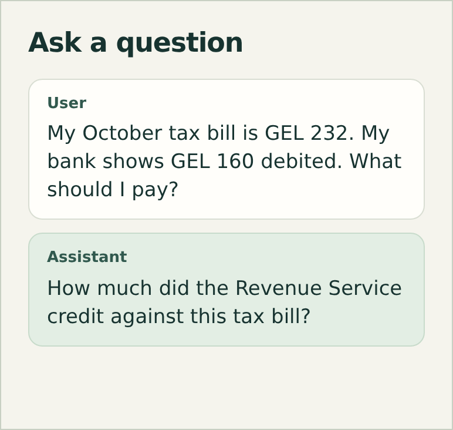
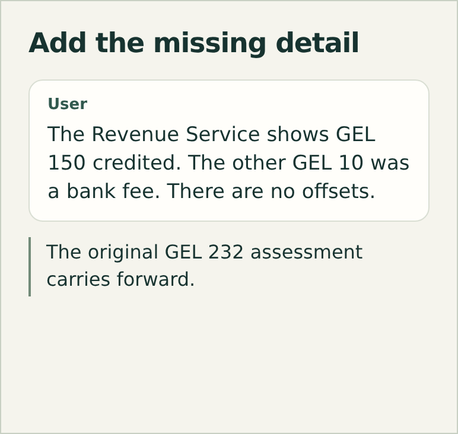
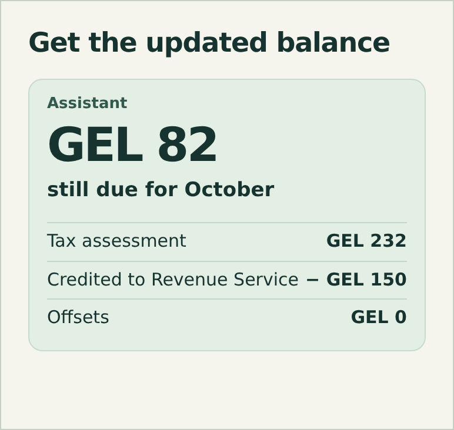

# Georgia Community Navigator

A Telegram assistant for newcomers in Georgia. It helps people figure out what paperwork applies to them and pick up where they left off when a detail changes.

[Try the interactive examples (RU)](https://podelu-delta.vercel.app/#how) · [Architecture](docs/architecture.md) · [Engineering decisions](docs/decisions.md) · [Quality and evaluation](docs/evaluation.md)

## A conversation about a tax payment

A bank shows a debit of GEL 160 against an October tax bill of GEL 232. The assistant asks what the Revenue Service actually credited. When the user confirms GEL 150 was credited, it carries the original bill forward and calculates the GEL 82 still due.

  
  
  

English excerpts from a recorded test conversation with synthetic inputs. [Read the original conversation and test scope](docs/evaluation.md#recorded-conversation).

## Why it matters

Administrative information is spread across government sites, practical guides and community discussions. Finding an official page still leaves newcomers with two questions. Which procedure applies to me? What should I do next?

The illustrated reference guide has **325 cards across 8 topics**, with source links and supporting files. It runs without model calls. The assistant uses that material to answer follow-up questions and keeps corrections and open questions in task memory so people can continue later.

## My role

I'm [Artem Shishkin](https://github.com/ashishki). I designed the product and its Telegram flows, built the Python backend, and tested source updates, answer quality and recovery after failures.

**Stack** · Python · FastAPI · PostgreSQL · Redis Streams · Docker

## Engineering decisions

If Telegram times out, the message may already be in the chat. The sender records the uncertain outcome and keeps receipts for individual parts of a response. On recovery it skips confirmed parts and avoids blindly resending an uncertain one.

PostgreSQL stores workflow state and delivery receipts. Redis Streams distributes jobs and supports reclaiming pending work. That lets the worker recover a job with the facts about which steps already ran. [Follow the request](docs/architecture.md) · [Read the tradeoffs](docs/decisions.md)

## Quality and evaluation

In the October 2026 operator-led guide check, **48 of 48 selected cards** were confirmed and **58 original illustrations** were covered, including one delivered inside a PDF. The check covered delivery and operator self-assessment. [Method and evidence](docs/evaluation.md#historical-guide-delivery-record)

This is a public case study. The application source is private.
