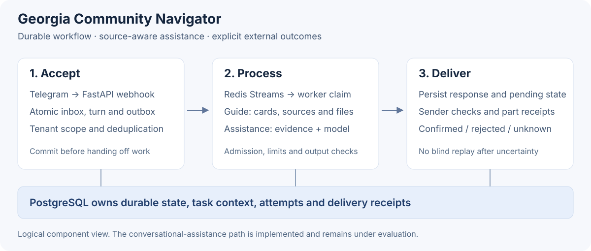

# Georgia Community Navigator

**A Telegram guide and AI assistance project for navigating administrative tasks in Georgia.**

I built the project end to end: product definition, architecture, backend, knowledge workflows and evaluation. The challenge was keeping guidance, user context, sources and delivery consistent across changing information and process failures.

**Author:** [Artem Shishkin](https://github.com/ashishki) · **Scope:** independent product and engineering · **Implementation:** private

[Architecture](docs/architecture.md) · [Engineering decisions](docs/decisions.md) · [Evaluation and results](docs/evaluation.md)

## The problem

People dealing with paperwork in Georgia piece together government websites, practical guides and community discussions. Generic answers can miss prerequisites or repeat outdated requirements. Returning later means reconstructing the task and its unresolved questions.

I split the product into two paths:

- **Reference guide:** browse illustrated cards, sources and files without making model calls.
- **Conversational assistance:** clarify a situation, retain corrections and propose a supported next step. Implemented and under evaluation; product acceptance remains open.

## What I built

- **325 guide cards across 8 topics**, derived from **196 source tasks**, with illustrations and source references.
- A transactional intake/outbox, asynchronous workers and delivery receipts that preserve state across restarts.
- Versioned task context, source-validity checks and model accounting, supported by behavioural tests and recorded conversation reviews.

## Architecture at a glance

PostgreSQL owns durable state; Redis carries work. Models interpret and explain; application code controls permissions, state transitions, dispatch and limits.

## Stack and why

| Technology | Purpose and rationale |
| --- | --- |
| Python 3.12+ and FastAPI | Async services alongside retrieval and evaluation code. |
| PostgreSQL, SQLAlchemy, Alembic | Transactions, tenant-scoped records and schema migrations. |
| Redis Streams | Consumer groups, acknowledgement and pending-job recovery. |
| HTTPX, JSON Schema, DeepSeek | Explicit provider calls, validated contracts and dispatch accounting. |
| Docker and Docker Compose | Containerized services and isolated optional research tooling. |
| pytest, Ruff, strict mypy | Behavioural checks, consistency and type checking. |

## Three decisions worth discussing

1. **Database-owned workflows:** queue redelivery must not blindly repeat external side effects.
2. **Explicit progress and evidence:** generating an instruction does not mean it was delivered, completed or remains valid.
3. **Accounting before dispatch:** an ambiguous provider timeout may still represent a billable request.

[Read the alternatives and tradeoffs →](docs/decisions.md)

## Results and current stage

The guide was accepted through delivery and self-assessment. Composite evidence covers **48 selected cards and all 58 original illustrations**. Native Telegram UI observation and independent usability testing were outside that acceptance.

Assistance checks exposed relevance, verbosity and overconfidence in older sources. I retained those findings alongside successful cases and kept acceptance open.

**A correctly delivered response can still fail to help the user.** Evaluation separates those outcomes.

[Results, scope and remaining work →](docs/evaluation.md)

## About this repository

This case study contains architecture, engineering decisions and aggregate results. Application code, private data and operational records remain private.
