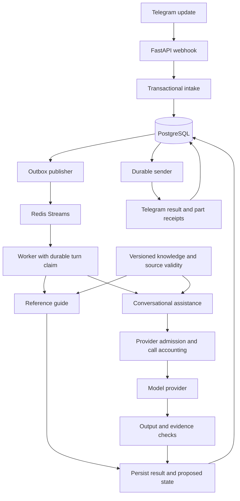

# Request flow and architecture

Georgia Community Navigator combines a reference guide with an evaluated conversational-assistance path. Both use the same durable processing and delivery foundation. Browsing the guide does not require a model call.

## Component flow

This is a logical component view. The assistance branch is implemented but has not completed product acceptance; the diagram is not a claim about a currently operating production deployment.

## 1. Accept the update durably

Intake creates the inbox record, ordered turn, job and outbox entry in one transaction. Tenant-scoped uniqueness constraints identify duplicate updates. A transaction failure rolls back the intake together rather than leaving a job without its owning turn.

The outbox publisher transfers committed work to Redis Streams. This avoids relying on an atomic transaction spanning PostgreSQL and Redis. Duplicate queue delivery is handled by durable claims and lifecycle checks.

## 2. Process under a durable claim

Redis consumer groups distribute work and track acknowledgement. Pending messages can be reclaimed, while the worker separately checks whether it can act on the database turn. A queue lease alone does not authorize state changes.

The guide path loads cards and associated sources or files. The assistance path uses the current task, corrections, unresolved needs and available evidence to prepare a response. Source versions and withdrawal state constrain what can be reused.

The model boundary is explicit: configured providers receive bounded requests; application code checks request admission, output structure, source references and accounting. A provider failure does not establish that a requested source or answer does not exist.

## 3. Persist the result before sending

A prepared response and its proposed task update are distinct from a confirmed delivery. Task memory carries pending delivery provenance so generation alone does not advance delivery-dependent state.

The sender reads the canonical stored payload. It records individual message parts and checks relevant source and privacy fences before dispatch. Confirmed parts can be skipped during recovery. A request that may already have reached Telegram is marked unknown rather than blindly sent again.

## 4. Keep the next interaction consistent

Task state distinguishes user-reported completion from a proposed instruction. Corrections update the retained context; source/version references allow later turns and cached material to reject withdrawn evidence.

Conversation deletion and access lifecycle operations invalidate content separately from retained operational and financial receipts. Tenant scoping and encrypted request storage are implemented controls; broader privacy guarantees require their own validation.

## Failure behaviour

| Event | Handling |
| --- | --- |
| Duplicate webhook update | Database uniqueness prevents another intake for the same tenant/update identity. |
| Worker stops | Queue recovery and durable turn claims determine whether processing can resume. |
| Provider result is ambiguous | Keep an unknown attempt and its accounting implications; do not assume a free retry. |
| A Telegram send may have happened | Preserve the unknown result and confirmed part receipts. |
| Evidence is withdrawn | Recheck validity across the relevant guide, assistance, retained-state and delivery paths. |

The tradeoff is additional lifecycle state and recovery logic. That complexity is justified by the need to reason about external side effects and changing evidence across process restarts. It does not provide exactly-once delivery across an external API.

[Engineering decisions](decisions.md) · [Evaluation and results](evaluation.md) · [Project overview](../README.md)
